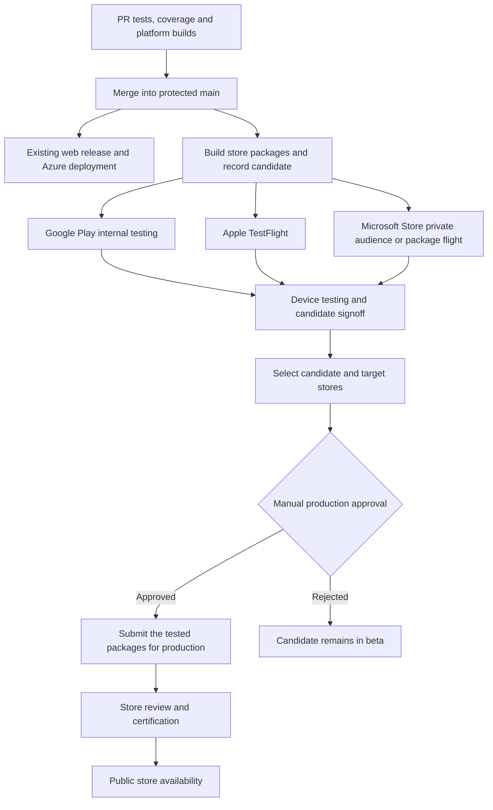

# Store deployment implementation plan

Copyright © 2026 myNOC LLC. All rights reserved.

Proposed implementation for Morse Code Trainer, prepared October 17, 2026.

After a validated PR merges into `main`, automatically build and distribute native candidates to beta testers. A separate manual GitHub approval authorizes promotion of a selected, tested candidate to production. Promote the same packages and store build identifiers used in beta; do not rebuild at promotion time.

The PR merge remains the source acceptance step. There is no additional human approval before beta distribution. Production approval is separate from merging and from the stores' own review processes.

## Release flow

Approval authorizes publication once the applicable store review succeeds; it does not promise immediate or simultaneous availability. A synchronized launch with another approval after store review would be a separate, optional enhancement.

| Platform | Automatic beta destination | Package to produce | Production action after approval |
| --- | --- | --- | --- |
| Android | Google Play internal testing; add closed testing when needed | Upload-key-signed Android App Bundle (`.aab`) | Assign the tested version code to the production track |
| iOS | TestFlight internal group initially; external group when configured | App Store distribution-signed device archive and `.ipa` | Select the processed TestFlight build for an App Store version and submit for review |
| Windows | Private audience for the first submission, then a named package flight | Store-associated MSIX package or bundle | Use the tested flight packages in a public submission |

These channels are supported by [Google Play testing tracks](https://support.google.com/googleplay/android-developer/answer/9845334), [TestFlight](https://developer.apple.com/help/app-store-connect/test-a-beta-version/testflight-overview/), and [Microsoft package flights](https://learn.microsoft.com/en-us/windows/apps/publish/package-flights).

## Changes needed in this repository

The current release produces a development Android APK, an unsigned iOS simulator build, and unpackaged Windows output. These validate compilation but are not store submission packages. The MAUI project uses `com.mynoc.morsecodetrainer`; the Windows manifest still contains a placeholder package identity.

Keep the required `validate / Required checks` status, all assembly test projects, and the 90% total and changed shared-code coverage gates. PRs continue to build all platforms without store credentials. Store release jobs consume protected `main` and perform packaging checks without repeating the full PR test suite.

Add explicit store publish profiles to the MAUI host. Preserve the pinned .NET 11 SDK/workloads and verify compatible, store-accepted Xcode and Android SDK versions before enabling uploads. A preview SDK build passing CI alone does not establish store eligibility. Review the existing minimum OS support table and generated package metadata for each candidate.

The Azure web deployment stays independent of the production store approval. A pending store review must not hold the web deployment open.

## Accounts and initial setup

Use myNOC LLC organization accounts where available. Inventory existing memberships, app records, and permissions before creating anything.

| Store | Setup required before automation |
| --- | --- |
| Google | Play Console account and app record; package name reservation through the initial app upload; Play App Signing; an upload keystore; tester list; Google Cloud project with the Play Developer API enabled and a service account granted access to this app |
| Apple | Apple Developer Program membership; registered bundle ID; App Store Connect app record; distribution certificate/private key and provisioning profile; API key; TestFlight groups; agreements and export-compliance information |
| Microsoft | Partner Center developer account; reserved app name and Store identity; first completed submission with age ratings; known tester group; package flight; Entra application associated with Partner Center |

Create listing descriptions, screenshots, icons, support/privacy-policy URLs, age ratings, and required privacy declarations. Explain microphone and camera access accurately: the application processes signals locally. Complete platform-specific declarations from the actual shipped implementation. Include © 2026 myNOC LLC and the project website.

Google requires API access to be configured in both Google Cloud and Play Console. For qualifying newer personal accounts, production access also requires a closed test with at least 12 testers opted in continuously for 14 days and an application for production access. Internal testing alone does not satisfy that requirement. Check the account type during setup. [API setup](https://developers.google.com/android-publisher/getting_started), [personal-account testing requirements](https://support.google.com/googleplay/android-developer/answer/14151465).

Microsoft package flights require an already published submission. Bootstrap this new app through Partner Center using a **Private audience** so only named testers can acquire it. Complete certification, then enable flight automation. Moving the app to Public is reserved for production approval; it cannot subsequently return to Private. This first submission is a setup milestone, not an exception allowing an early public release. [Private audience and beta distribution](https://learn.microsoft.com/en-us/windows/apps/publish/beta-testing-and-targeted-distribution), [visibility rules](https://learn.microsoft.com/en-us/windows/apps/publish/publish-your-app/msix/visibility-options).

## Build once and identify every candidate

Continue using GitVersion for the display version. Add one persisted, monotonically increasing build ordinal allocated by the candidate workflow. Map it to Android `versionCode`, Apple's numeric build version, and a Store-compliant Windows package version. Validate each platform's numeric limits and Windows' reserved final component; do not assume an arbitrary GitHub run ID fits every store format.

A candidate record must include:

- GitVersion, source commit, release tag, workflow run and attempt, and build ordinal.
- Platform package versions, application identities, architectures, minimum OS versions, and SDK/workload/Xcode versions.
- Exact artifact IDs, package names, SHA-256 hashes, and build provenance.
- Store-returned build, version-code, flight, and submission identifiers, plus beta availability status.
- Release notes and a reference to device-test evidence for that candidate.

Store package files, the initial candidate manifest, and append-only deployment receipts durably with the release. Promotion must not depend on an expiring Actions artifact or a mutable "latest" link. Verify the manifest and package hashes against the trusted build run before use. Never overwrite an existing candidate with different package bytes.

Retry uploads using their recorded store IDs. If a new binary must be built after a failed or superseded candidate, allocate a new build ordinal. Promotion never changes package versions. A newer beta may coexist with an older production candidate, provided the selected candidate is still eligible and newer than production.

## Android implementation

Publish a Release AAB with the upload keystore, using the same application ID for testing and production. Play App Signing handles the app signing key; keep the upload key backed up securely outside the repository. Validate the generated target API against the then-current Play requirement independently of the minimum supported Android version.

Use PowerShell and the Google Play Developer API to upload the bundle, update the configured internal testing track, and commit the edit. Discover and verify the actual track identifier from the API rather than guessing it. Record the returned version code and confirm that the candidate is available to the intended testers.

Production promotion opens a new edit and assigns that recorded version code to production. It does not upload a different bundle. Start with a full first release where required; support an explicitly selected staged rollout for later updates. [Track and rollout API](https://developers.google.com/android-publisher/api-ref/rest/v3/edits.tracks).

Use standard publication after review for the initial automated design. If Managed publishing is already enabled, preserve it and report the additional Play Console publish step; do not silently turn it off or mark a held release as live. Internal testing is not held by Managed publishing, and initial/rejected submissions can still need review. [Review and publication controls](https://support.google.com/googleplay/android-developer/answer/9859654).

## Apple implementation

Build on a Mac with the pinned compatible Xcode and MAUI workload, targeting `ios-arm64`. Produce an App Store distribution archive/IPA with the correct certificate, provisioning profile, entitlements, and privacy manifest. Use a temporary keychain and remove imported keys and profiles in an unconditional cleanup step.

Upload through an Apple-supported command-line uploader invoked by PowerShell, then manage processing and tester groups with the App Store Connect API. Start with an internal TestFlight group; external testers can be added later with the required beta review. Beta builds expire after 90 days. [Upload tooling](https://developer.apple.com/help/app-store-connect/manage-builds/upload-builds/), [TestFlight lifecycle](https://developer.apple.com/help/app-store-connect/test-a-beta-version/testflight-overview/).

Use a normal App Store-eligible upload even when distributing only to internal testers. Do not use **TestFlight Internal Only**, because those builds cannot later be submitted to customers. [Internal testing restrictions](https://developer.apple.com/help/app-store-connect/test-a-beta-version/add-internal-testers).

After GitHub production approval, select the exact processed build, apply the approved release notes and listing metadata, and submit its App Store version for review. Configure release after Apple approval. If an exact launch-time hold is later required, use Pending Developer Release and add an explicit release action. TestFlight review is separate from production App Review. [Apple release options](https://developer.apple.com/help/app-store-connect/manage-your-apps-availability/select-an-app-store-version-release-option/).

## Microsoft implementation

Replace the placeholder Windows identity with the identity and publisher supplied by Partner Center, and introduce a packaged Store publish profile instead of `WindowsPackageType=None`. Initially target Windows x64; add ARM64 only with build and device coverage. Preserve the supported Windows minimum version.

Generate Store-ready MSIX output, validate dependencies and packaged startup, and run the Windows App Certification Kit. Microsoft signs Store-distributed MSIX packages; purchasing a separate public code-signing certificate is not a prerequisite for this route. Local sideload testing may need a separate trusted test signature. [Windows packaging and Store signing](https://learn.microsoft.com/en-us/windows/apps/package-and-deploy/publish-first-app).

After the private bootstrap submission, upload candidates to a fixed tester flight using the packaged-app submission API. Promote the same packages into a non-flighted public submission after approval. If the API requires uploading them again, use the exact retained files. Flight certification is not a substitute for production certification. [Package flight promotion](https://learn.microsoft.com/en-us/windows/apps/publish/package-flights).

Use PowerShell REST calls; evaluate Microsoft's StoreBroker module only if it supports the pinned PowerShell runtime and needed operations. Keep API-created submissions under API control to avoid conflicting portal edits. Configure production publication after certification only in the approved promotion job. [Submission API and PowerShell support](https://learn.microsoft.com/en-us/windows/uwp/monetize/manage-app-submissions).

## GitHub workflows and approval controls

Proposed workflow responsibilities:

| File | Responsibility |
| --- | --- |
| `.github/workflows/release.yml` | Calculate the version and launch automatic candidate packaging/distribution after a merge; keep web deployment independent |
| `.github/workflows/store-beta.yml` | Build store packages, upload them to beta destinations, and write candidate receipts; callable only from trusted main releases |
| `.github/workflows/store-promote.yml` | Manually select a candidate and one or more stores, show the proposed production changes, await approval, then submit promotions |
| `.github/workflows/store-status.yml` | Resume status checks for an existing submission without re-uploading or rebuilding; available manually when store processing outlives a job |

Refactor common build configuration so an enabled store package is built once per candidate. Retain unsigned development profiles for PR validation. Store setup can be enabled per platform, but a failed enabled platform must report failure and cannot be labeled ready.

Use separate automatic beta environments for Google, Apple, and Microsoft. Add a `stores-production` environment with Eric as a required reviewer, deployment restricted to `main`, and administrator bypass disabled. The promotion workflow's production job must reference that environment directly and obtain production credentials only after approval. Selecting a candidate through `workflow_dispatch` is not itself the approval.

Use one approval for the selected store set. A single protected promotion job can orchestrate API-only promotions from PowerShell and record each result independently. An approval summary must show the candidate version, commit, package hashes, beta status, device-test evidence, countries, and rollout scope. Recheck store state immediately after approval, including superseded versions and changed metadata. Changed candidate bytes or publication scope require a new request and approval.

Keep self-approval available while Eric is the sole reviewer, so he can approve a run he initiated. If a second release owner is appointed, enable prevention of self-review. The repository is public, so GitHub's required environment reviewers are available on the ordinary plans that support this feature. [GitHub environment protection](https://docs.github.com/en/actions/reference/workflows-and-actions/deployments-and-environments).

Do not hold a runner for days waiting on store review. Persist submission IDs and distinguish uploaded, processing, available to testers, submitted for review, approved, and live states. Resume checks in a later status run. Serialize submissions for the same store/app and reject stale promotion attempts after acquiring that lock.

## Credentials and automation code

Use PowerShell 7.4+ for orchestration, REST requests, and calls to native packaging/upload tools. Keep scripts under `scripts/` and Pester tests under `tests/ci/`. No Python runtime is needed.

| Destination | Credentials and configuration |
| --- | --- |
| Google beta | Upload keystore and passwords; tester-release service identity; package name and verified testing track |
| Apple beta | Distribution certificate/private key and password; provisioning profile; upload/TestFlight API key, key ID, issuer/team/app IDs and group ID |
| Microsoft beta | Partner Center Entra tenant/client credentials; Store application identity and flight ID |
| Production | Separate store credentials with production publication permissions, stored only in `stores-production`; no signing keys needed to promote |

Prefer short-lived federation where supported and verified during setup; otherwise use scoped, rotated environment secrets. Restrict credentials to this application and separate beta and production permissions wherever the store supports that distinction. Confirm role limitations with actual test calls before claiming that beta credentials cannot publish publicly.

Pin external actions and tools, prevent secrets from reaching fork/PR jobs, redact tokens and upload URLs, and upload only allowlisted package files. In reusable workflows, explicitly declare and forward required secrets. Store keystores, API private keys, signing certificates, and tester email lists outside Git and release assets.

Suggested helpers are `New-StoreCandidate.ps1`, `Publish-StoreBeta.ps1`, `Promote-StoreRelease.ps1`, and `Get-StoreSubmissionStatus.ps1`, with platform adapters and a shared manifest schema. Use bounded retries for throttling/transient errors and idempotency checks before every mutating request.

## Implementation stages and acceptance

1. **Provision accounts and identities.** Confirm store ownership, memberships, credentials, listing data, tester groups, and Microsoft's private bootstrap submission. Verify API permissions without publishing publicly.
2. **Implement package profiles and candidate records.** Produce valid AAB, device IPA, and MSIX outputs; inspect identities, versions, signatures, architectures, and minimum OS metadata. Add version-allocation and manifest validation tests.
3. **Enable automatic beta distribution.** Implement each store adapter and exercise one candidate on each channel. Install through each store's testing mechanism on real devices and record the exact build used.
4. **Implement production selection and approval.** Reject untrusted/missing artifacts, failed beta uploads, missing device evidence, invalid versions, and stale submissions. Demonstrate that a rejected approval performs no production mutation and an approved run promotes only its selected candidate/stores.
5. **Exercise recovery and document operations.** Test partial success, duplicate uploads, credential expiry, review rejection, timeouts, and retries. Document key rotation, tester management, store status checks, and first-release steps.

Pester tests must cover version boundaries and monotonicity, package/hash mismatches, wrong app IDs, production permission separation, retry behavior, partial failure, and credential redaction. Mock store responses in PRs. Keep MSTest/NSubstitute for application behavior, every source assembly's test project, and the existing coverage thresholds. Validate workflows with actionlint and use restricted real-store integration tests during rollout.

Complete [the device acceptance checklist](device-validation.md) against store-installed candidates, including microphone/camera permissions, cancellation, backgrounding, Morse timing, clean installation, and upgrades on the minimum and current supported OS releases. These behaviors remain unverified until real-device results are recorded.

If one store rejects a submission, preserve successful submissions for the others and retry only the affected operation. Halt an eligible staged rollout or remove availability when necessary; a store action does not reliably downgrade existing installations. Fixes normally require a new, higher-version candidate through the same testing and approval process.

Implementation is complete when a merge automatically reaches the configured beta audiences, a production request cannot proceed without approval, and the exact beta-tested build can be released through each store with an auditable result. Store reviews and account enrollment may take longer than the coding work.

## Inputs needed before implementation

- Existing myNOC LLC developer-account status and app IDs for each store.
- Initial tester groups, and whether Apple's external TestFlight testing is needed immediately.
- Production countries, pricing, support address, and privacy-policy URL.
- Secure signing/API credential setup and the preferred backup owner.
- Confirmation of the default full first release and any staged rollout policy for updates.

The approval model is already decided: **automatic beta after merge, manual approval for production**. Account setup, workflow changes, and store submissions are implementation work following review of this plan.
